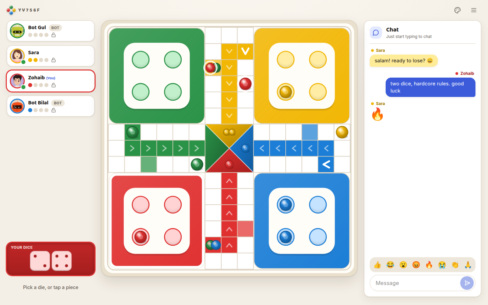
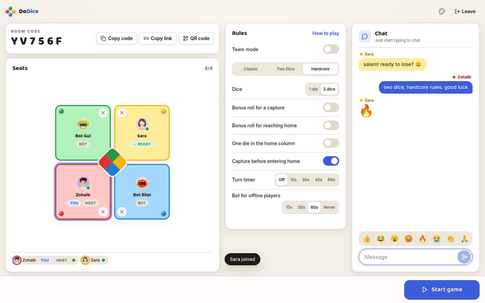
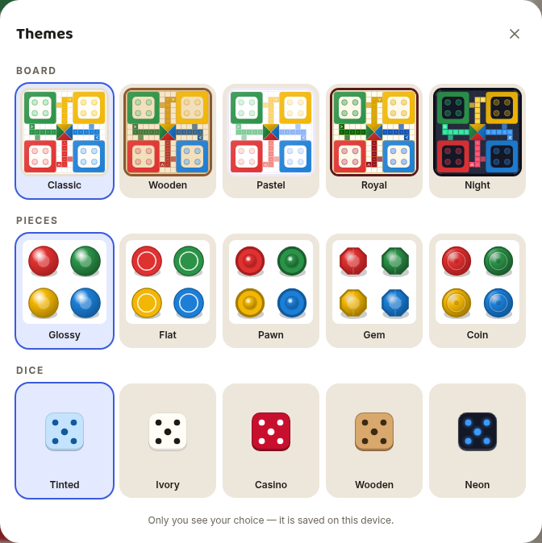
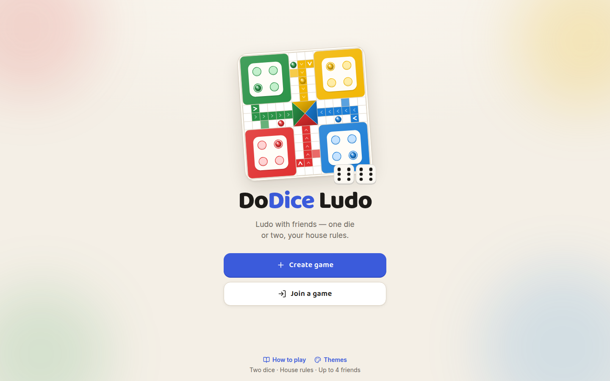
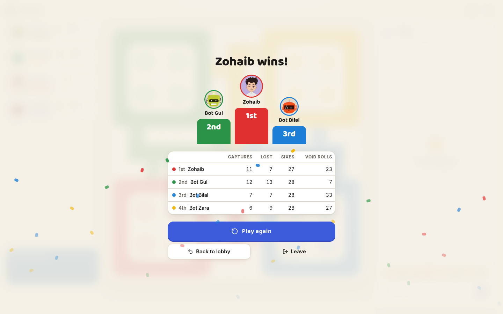
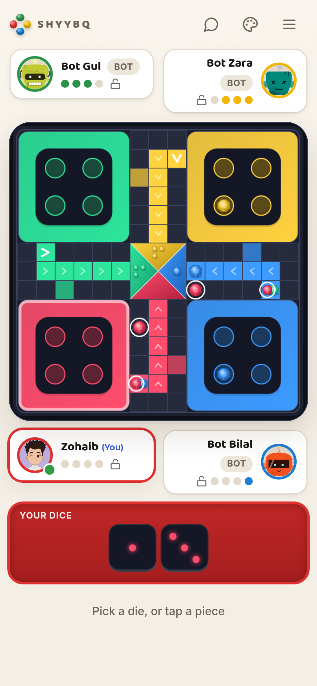

# DoDice Ludo

**Online Ludo for friends, with two dice and real house rules.** Share a room code, take a corner, and play in the browser on any phone or computer. No accounts and no installs.



## What makes it different

DoDice is Ludo as it is played at home, with the rules friends actually argue about, built in:

- **Two dice, played separately.** Roll both, then move each die on its own, on one piece or two.
- **All or nothing.** If you can't use every die, the whole roll is lost.
- **Double six rolls again,** with no limit, and every six is kept.
- **Capture before you go home.** You can't enter your home column until you've captured someone. If nobody is left to capture, you're out.
- **Teams.** Red and Yellow play Green and Blue. A pair of teammates on one square can only be captured by both enemies together.
- **Host's choice.** One die or two, bonus rolls for captures and finishing, a turn timer, and three presets: Classic, Two Dice and Hardcore.

The full rules are in [RULES.md](RULES.md), and the in-game **How to play** page explains them with pictures.

## Screenshots

| Lobby: seats, rules and chat          | Pick your look                      |
| ------------------------------------- | ----------------------------------- |
|        |    |
| **Start screen**                      | **Results**                         |
|  |  |

<p align="center"></p>

## Features

- **Rooms by code or link.** Up to 4 players plus people watching, with a QR code for the people next to you.
- **Bots** fill empty seats, play for anyone whose turn timer runs out, and take over offline players.
- **Never lose your seat.** Refresh, switch networks or lose signal, and you're put straight back. If the server restarts, your room comes back with the same code, everyone's seats, the rules and the bots.
- **Your own style.** 5 boards, 5 piece styles and 5 dice styles, plus generated avatars. Each player's choice is saved in their own browser.
- **Chat and quick reactions,** sounds made in the browser, vibration on your turn, and a layout made for phones as well as desktops.
- **Accessible.** Keyboard play (Space rolls), screen-reader announcements, colour-blind markers and reduced motion.

## Run it locally

You need **Node.js 22 or newer** (with npm).

```bash
npm install

# terminal 1: the game server (http://localhost:2567)
npm run server

# terminal 2: the web app (http://localhost:5173)
npm run dev:web
```

Open http://localhost:5173, press **Create game**, and share the room link. Friends on the same Wi-Fi can open the app at your computer's local address, for example `http://192.168.1.20:5173`. To test alone, open a second browser window (or a private one) and join your own room, or fill the empty seats with bots.

> If the page stays blank after you pull new changes or install packages, restart the web app with `npm run dev:web -- --force` so it rebuilds its module cache.

## Scripts

| Command                           | What it does                                                  |
| --------------------------------- | ------------------------------------------------------------- |
| `npm run server`                  | Starts the game server (`PORT` sets the port, default 2567)   |
| `npm run dev:web`                 | Starts the web app with live reload                           |
| `npm test`                        | Unit and integration tests (rules engine, bot, server, web)   |
| `npm run e2e`                     | Browser tests with Playwright (starts its own servers)        |
| `npm run typecheck`               | Type-checks every package                                     |
| `npm run lint` / `npm run format` | ESLint / Prettier                                             |
| `npm run sim`                     | Plays random games in six setups to check the rules engine    |
| `npm run arena`                   | Pits the bot against simpler players and reports its win rate |

For browser tests, install Chromium once with `npx playwright install chromium`.

## Deploying

The web app is a static site and the game server is a small Node process, so they can be hosted separately:

```bash
# Web app: build with the server's address baked in, then host apps/web/dist anywhere static
VITE_SERVER_URL=https://your-game-server.example.com npm run build -w @ludo/web

# Game server: any host that keeps WebSocket connections open
PORT=8080 npm run server
```

Rooms live in the server's memory. If the server restarts, players are reconnected to a fresh copy of their room automatically, but a game in progress has to be started again.

## How it's built

| Package             | What it is                                                                                      |
| ------------------- | ----------------------------------------------------------------------------------------------- |
| `packages/engine`   | The rules: pure TypeScript with no dependencies, fully tested, shared by the server and the bot |
| `packages/protocol` | Shared types, presets and limits for the client and server                                      |
| `packages/bot`      | A heuristic bot that plans a whole roll at a time                                               |
| `apps/server`       | The game server, built on [Colyseus](https://colyseus.io). It owns the game and rolls the dice  |
| `apps/web`          | The web app: React, an SVG board, Motion animations and Tailwind CSS                            |
| `e2e`               | Playwright tests that play real games in real browsers                                          |

The design documents (product, visual design, architecture, engine, protocol, bot, testing and roadmap) are in [docs/](docs/README.md).

## Credits

Avatars are made with [DiceBear](https://www.dicebear.com): Avataaars and Bottts by Pablo Stanley, and ToonHead by Johan Melin under [CC BY 4.0](https://creativecommons.org/licenses/by/4.0/). All other artwork, sounds and themes are drawn in code.
